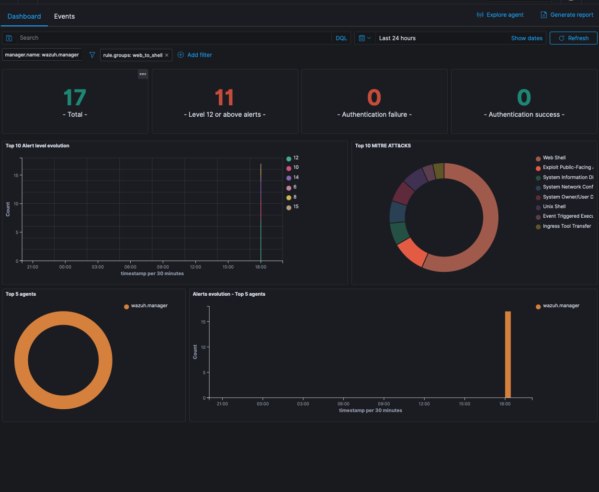

# shellcatch

Validated Wazuh detections for the Wazuh Ambassador program.

**📖 Read the write-up:** https://samsploit1.github.io/shellcatch/

---

## Detections

### [web-to-shell (PHP & Node.js)](detections/web-to-shell)
Detects web runtimes spawning processes — webshells, command injection, and the
post-exploitation step of RCE such as React2Shell (CVE-2025-55182). Three layers
(auditd process execution, web-request payloads, FIM webshell drops), all
MITRE-mapped, validated 42/42 against a live
`wazuh-manager` logtest engine. Includes a Docker lab and step-by-step
[install guide](detections/web-to-shell/INSTALL.md).

---

### [wazuh-selfmon (Wazuh watching Wazuh)](detections/wazuh-selfmon)
Catches the outages where every service says `active` and nothing is being
processed: missing daemons, analysisd and UDP event loss, flood-stage write
blocks, failed ISM, a wedged filebeat (via an end-to-end canary). CRITICALs go
out-of-band, because a dead manager can't alert about itself. 22/22 logtest
cases and 7 fault scenarios reproduced on a live 4.14.9 stack.

---

See [SUBMISSIONS.md](SUBMISSIONS.md) for the full contribution log.
